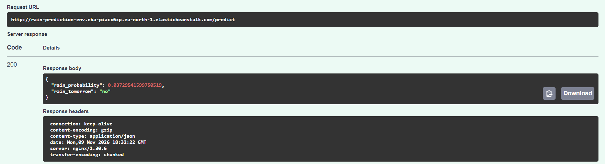
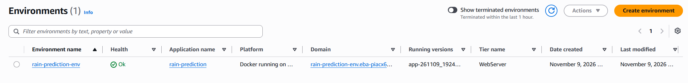
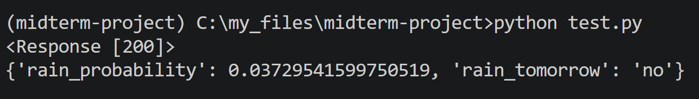

# Rain in Australia: Predicting `RainTomorrow`

A machine learning project that predicts **whether it will rain tomorrow** at an Australian weather station from today's weather observations. The best model (XGBoost, test ROC AUC 0.89) is served as a web service with **FastAPI**, packaged with **Docker**, and deployed to **AWS Elastic Beanstalk**.



## Contents

- [Problem description](#problem-description)
- [Dataset](#dataset)
- [Project structure](#project-structure)
- [Approach and results](#approach-and-results)
- [How to run the project](#how-to-run-the-project)
  - [1. Set up the environment](#1-set-up-the-environment)
  - [2. Train the model (notebook)](#2-train-the-model-notebook)
  - [3. Run the web service locally](#3-run-the-web-service-locally)
  - [4. Run it with Docker](#4-run-it-with-docker)
  - [5. Deploy to AWS Elastic Beanstalk](#5-deploy-to-aws-elastic-beanstalk)
  - [6. Delete the AWS environment](#6-delete-the-aws-environment)
- [Using the API](#using-the-api)
- [Deployment screenshots](#deployment-screenshots)
- [Other deployment options](#other-deployment-options)

## Problem description

Knowing whether it will rain tomorrow matters for farming, outdoor events, construction, water management and everyday planning. Weather stations record many measurements every day: temperature, humidity, pressure, wind and rainfall. The question is whether **today's measurements** are enough to predict **rain tomorrow**.

This is a **binary classification** problem:

- **Input:** one day's observations at one weather station (location, temperatures, humidity, pressure, wind, today's rainfall...).
- **Output:** the probability that it will rain tomorrow, and a yes/no answer (`yes` if the probability is at least 0.5).

The classes are imbalanced: it rains on about **22%** of the days. A "model" that always says *no rain* is already 78% accurate, so models are compared mainly by **ROC AUC**, which measures how well the model ranks rainy days above dry days.

## Dataset

**Rain in Australia** ([Kaggle](https://www.kaggle.com/datasets/jsphyg/weather-dataset-rattle-package)), file `weatherAUS.csv`: about 10 years of daily observations from 49 Australian weather stations (275,410 rows, 24 columns).

If `weatherAUS.csv` is not in the project folder, download it from the Kaggle page and place it next to the notebook.

| Column | Meaning |
|---|---|
| `Date`, `Location` | Observation date and weather station |
| `MinTemp`, `MaxTemp`, `Temp9am`, `Temp3pm` | Temperatures (°C) |
| `Rainfall` | Rain during the day (mm) |
| `Evaporation`, `Sunshine` | Evaporation (mm), hours of sunshine |
| `WindGustDir`, `WindGustSpeed` | Direction and speed (km/h) of the strongest wind gust |
| `WindDir9am`, `WindDir3pm`, `WindSpeed9am`, `WindSpeed3pm` | Wind direction and speed at 9am and 3pm |
| `Humidity9am`, `Humidity3pm` | Relative humidity (%) |
| `Pressure9am`, `Pressure3pm` | Atmospheric pressure (hPa) |
| `Cloud9am`, `Cloud3pm` | Cloud cover (eighths of the sky) |
| `RainToday` | `Yes` if today's rainfall is more than 1 mm |
| `RISK_MM` | Amount of rain **tomorrow** (mm). Not used: it leaks the answer |
| `RainTomorrow` | **Target:** `Yes` if tomorrow's rainfall is more than 1 mm |

## Project structure

```
midterm-project/
├── weather_forecasting.ipynb   # the full tutorial: EDA, cleaning, models, saving the model, deployment steps
├── weatherAUS.csv              # the dataset
├── weather_forecast.bin        # the saved model (pickle): train_medians, categorical, DictVectorizer, XGBoost model
├── predict.py                  # FastAPI web service that loads the model and serves POST /predict
├── test.py                     # sends a sample weather record to the service and prints the answer
├── Dockerfile                  # builds the Docker image of the web service (every line is commented)
├── .ebignore                   # which files the EB CLI uploads to AWS (only the 5 needed for the Docker build)
├── .elasticbeanstalk/          # EB CLI settings created by `eb init` (not in Git: run `eb init` to recreate it)
├── pyproject.toml, uv.lock     # Python dependencies, managed with uv
├── .python-version             # Python version (3.11)
└── images/                     # screenshots of the deployed service
```

## Approach and results

All the steps are explained in detail in [`weather_forecasting.ipynb`](weather_forecasting.ipynb).

**Data cleaning**

- Rows with an unknown target are dropped; the target is encoded as 1 (`Yes`) / 0 (`No`).
- Dropped columns:
  - `Sunshine`, `Evaporation`, `Cloud9am`, `Cloud3pm`: about 45–60% missing values, too many to fill reliably.
  - `Date`: dropped to keep things simple.
  - `RISK_MM`: the amount of rain *tomorrow*. `RainTomorrow` is defined from it, so using it would be **data leakage**.
- Remaining missing values: numerical columns are filled with the **median of the training set**, categorical columns with a new category `'Missing'`.

**Split:** 60% train / 20% validation / 20% test (`random_state=1`). Models are compared on validation; the test set is used **once**, for the final model.

**Exploratory data analysis** (on train + validation):

- If it rained today, rain tomorrow is about 2 times more likely than average. `RainToday` is the most informative categorical feature (mutual information), followed by `Location`.
- `Humidity3pm` is the numerical feature most correlated with rain tomorrow, followed by `Humidity9am`, `Rainfall`, `WindGustSpeed` and pressure.

**Models** (categorical features one-hot encoded with `DictVectorizer`). Validation scores:

| Model | Accuracy | ROC AUC |
|---|---|---|
| **XGBoost** (`n_estimators=200`, `learning_rate=0.3`) | **0.8657** | **0.8936** |
| Random Forest (`n_estimators=200`) | 0.8605 | 0.8851 |
| Logistic Regression (`liblinear`) | 0.8499 | 0.8635 |
| Decision Tree (`max_depth` tuned on validation) | 0.8462 | 0.8469 |
| Baseline (always "no rain") | 0.7795 | 0.5000 |

**Final model:** XGBoost retrained on train + validation (80% of the data) and evaluated once on the test set:

| | Validation | Test |
|---|---|---|
| Accuracy | 0.8657 | 0.8634 |
| ROC AUC | 0.8936 | 0.8935 |

The test scores are almost identical to the validation scores, so the model generalizes well to unseen data.

The model is saved to `weather_forecast.bin` together with everything needed to turn a raw record into a prediction: the training medians, the list of categorical columns and the fitted `DictVectorizer`.

## How to run the project

**Requirements:** [uv](https://docs.astral.sh/uv/) (installs Python 3.11 and all packages), [Docker Desktop](https://www.docker.com/products/docker-desktop/) for step 4, and an AWS account with the [AWS CLI](https://aws.amazon.com/cli/) and the [EB CLI](https://docs.aws.amazon.com/elasticbeanstalk/latest/dg/eb-cli3.html) for step 5.

All commands are run from the project folder.

### 1. Set up the environment

```bash
uv sync
```

This creates `.venv` and installs the exact package versions from `uv.lock` (pandas, scikit-learn, xgboost, fastapi, uvicorn, requests...). Run any script with `uv run`, or activate `.venv` first.

### 2. Train the model (notebook)

Open `weather_forecasting.ipynb`, select the `.venv` kernel and run all cells. Section 8 retrains the final model and saves `weather_forecast.bin`. (The file is already included, so this step is only needed to reproduce it.)

### 3. Run the web service locally

```bash
uv run python predict.py
```

The service listens on port 9696. In a **second** terminal:

```bash
uv run python test.py
```

Expected output:

```
<Response [200]>
{'rain_probability': 0.03729541599750519, 'rain_tomorrow': 'no'}
```

You can also open **http://localhost:9696/docs**, FastAPI's interactive test page: click **POST /predict**, then **Try it out**, paste a record and click **Execute**. (Open `localhost`, not `0.0.0.0`.)

Stop the service with `Ctrl+C`.

### 4. Run it with Docker

Start Docker Desktop, then build the image and run a container:

```bash
docker build -t rain-prediction .
docker run -it --rm -p 9696:9696 rain-prediction
```

`-p 9696:9696` connects port 9696 on your computer to the container's port 9696. Test it exactly like in step 3 (`uv run python test.py` or http://localhost:9696/docs). Make sure the local `predict.py` server from step 3 is stopped first, because both use port 9696.

### 5. Deploy to AWS Elastic Beanstalk

The AWS CLI must be configured (`aws configure`) and the EB CLI installed (for example `uv tool install awsebcli`).

```bash
# create the EB application (free: only a name and settings)
eb init -p docker -r eu-north-1 rain-prediction

# create the environment: one machine, no load balancer (costs start here)
eb create rain-prediction-env --single
```

`eb create` uploads only the files allowed by `.ebignore`, then AWS builds the Docker image and starts the container. It takes 5–10 minutes and prints the public URL at the end:

```
INFO    Application available at rain-prediction-env.eba-piacx6xp.eu-north-1.elasticbeanstalk.com.
INFO    Successfully launched environment: rain-prediction-env
```

To test it, change the `url` line in `test.py` to the EB address (no port number is needed: nginx on the machine forwards port 80 to the container's port 9696):

```python
url = "http://<your-environment-url>/predict"
```

and run `uv run python test.py`, or open `http://<your-environment-url>/docs`.

Useful commands: `eb status` (health and URL), `eb logs` (errors), `eb deploy` (upload code changes).

### 6. Delete the AWS environment

The environment costs money while it runs. Delete it when you're done:

```bash
eb terminate rain-prediction-env
```

It asks you to type the environment name to confirm, and takes about 3–5 minutes. It deletes the machine, its IP address and its firewall rules. The application and the uploaded versions in S3 stay, and they are free or practically free. The notebook (section 11.5) shows how to check that nothing is left running and how to remove the application completely.

> **Note:** the environment used for this project has already been deleted, so the URL in the screenshots no longer works. Running `eb create` again gives a new URL.

## Using the API

**Endpoint:** `POST /predict`. The request body is one day's weather as JSON:

```json
{
  "Location": "Launceston",
  "WindGustDir": "SE",
  "WindDir9am": "ENE",
  "WindDir3pm": "N",
  "RainToday": "No",
  "MinTemp": 0.0,
  "MaxTemp": 13.0,
  "Rainfall": 0.0,
  "WindGustSpeed": 22.0,
  "WindSpeed9am": 7.0,
  "WindSpeed3pm": 6.0,
  "Humidity9am": 81.0,
  "Humidity3pm": 49.0,
  "Pressure9am": 1020.2,
  "Pressure3pm": 1017.3,
  "Temp9am": 6.2,
  "Temp3pm": 12.4
}
```

**Response:**

```json
{"rain_probability": 0.03729541599750519, "rain_tomorrow": "no"}
```

Missing or `null` fields are allowed: they are filled the same way as during training (the training median for numbers, `'Missing'` for categories). Unknown extra fields are ignored.

Example with `curl` (bash):

```bash
curl -X POST http://localhost:9696/predict \
  -H "Content-Type: application/json" \
  -d '{"Location": "Launceston", "RainToday": "No", "Humidity3pm": 49.0, "Pressure3pm": 1017.3}'
```

## Deployment screenshots

The environment running on AWS Elastic Beanstalk (health *Ok*, Docker platform):



A prediction request to the deployed service on the `/docs` page:


`test.py` sending the request to the deployed service:



## Other deployment options

Elastic Beanstalk is the simplest way to run an always-on web service on AWS. Alternatives include **AWS Lambda** (serverless, pay per request, needs a Lambda handler instead of FastAPI), **Kubernetes on EKS** (for large systems), a plain **EC2** machine, and **App Runner / ECS Fargate**. Section 12 of the notebook compares them.
